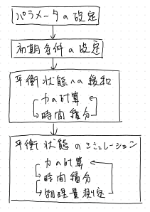
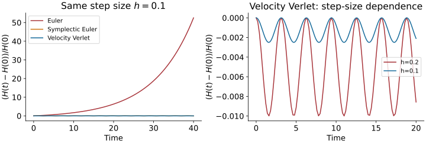
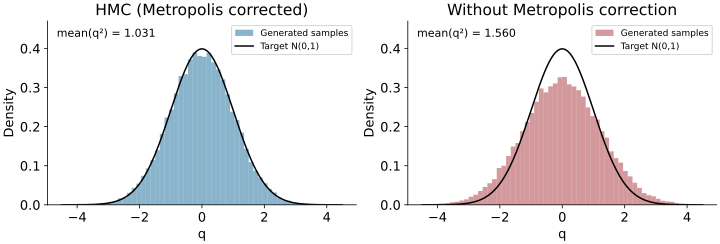
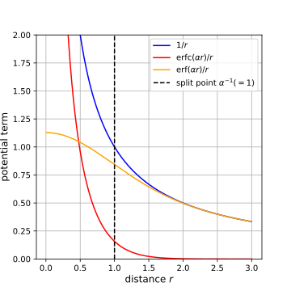
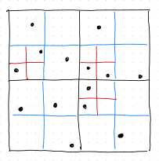
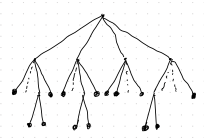

## 本日の到達目標

- 運動方程式の時間積分と、平衡分布からのサンプリングを区別する
- 速度ベルレ法を実装し、刻み幅と保存量を使って検証する
- 温度の平均値だけでなく、分布とゆらぎを確認する
- 力学による提案とMetropolis採択を組み合わせ、HMCを構成する

## 講義1・実習1とのつながり

- 前回：カノニカル分布、詳細つりあい、Metropolis法
- 小さな提案では自己相関が残り、大きな提案では棄却が増える
- 今回：勾配（力）を利用して、遠くまで移動する提案をつくる
- 平衡化・自己相関・ビニングによる誤差評価は引き続き必要

$$
\pi(q)\propto e^{-\beta U(q)},\qquad
\beta=\frac{1}{k_{\mathrm B}T}
$$

# 分子動力学とアンサンブル

## 古典多粒子系

$$
H(q,p)=K(p)+U(q),\qquad K(p)=\sum_{a=1}^{d}\frac{p_a^2}{2m_a}
$$

$$
\dot q_a=\frac{p_a}{m_a},\qquad
\dot p_a=F_a(q)=-\frac{\partial U}{\partial q_a}
$$

- $q,p$：座標と運動量。拘束のない3次元 $N$ 粒子系では $d=3N$
- $6N$ 本の1階常微分方程式を、初期条件から数値積分する
- 以下、運動エネルギーを $K$、温度を $T$ と書く

## 相互作用と力の計算

$$
U=\sum_{i<j}v(r_{ij}),\qquad
v(r)=4\epsilon\left[\left(\frac{\sigma}{r}\right)^{12}
-\left(\frac{\sigma}{r}\right)^6\right]
$$

$$
\mathbf F_{ij}=24\epsilon\left[2\left(\frac{\sigma}{r_{ij}}\right)^{12}
-\left(\frac{\sigma}{r_{ij}}\right)^6\right]
\frac{\mathbf r_i-\mathbf r_j}{r_{ij}^2}
$$

- Lennard-Jonesポテンシャル：短距離での斥力と、長距離側での引力
- 同じ粒子対について $\mathbf F_{ji}=-\mathbf F_{ij}$ を同時に加算する
- 解析的な力を、ポテンシャルの中心差分と照合する

## 周期境界条件とカットオフ

- 一辺 $L$ の立方体を周期的に繰り返し、表面の影響を減らす
- 最近接像（minimum image）の相対座標を成分ごとに計算

$$
\Delta r_\alpha\leftarrow\Delta r_\alpha
-L\,\mathrm{round}(\Delta r_\alpha/L)
$$

- 短距離相互作用では $r_c<L/2$ とし、$r_{ij}<r_c$ の対を扱う
- 力を不連続に切ると積分精度が悪化する。力も滑らかに接続する
- 重力・静電相互作用は単純な打切りで物理が変わる（補足参照）

## 分子動力学の計算手順

{height="480" fig-align="center" fig-alt="初期条件設定、力の計算、運動方程式の積分、物理量測定を繰り返す分子動力学のフローチャート"}

## 時間平均とミクロカノニカル平均

$$
\langle A\rangle_E=
\frac{\int A(q,p)\,\delta(H(q,p)-E)\,dq\,dp}
{\int\delta(H(q,p)-E)\,dq\,dp}
$$

$$
\overline A_t=\frac{1}{t_{\max}}\int_0^{t_{\max}} A(q(t),p(t))\,dt
$$

- 孤立系の厳密な力学は、時間に依存しない $H$ を保存する
- $\overline A_t\to\langle A\rangle_E$ には、対象とする不変集合上のエルゴード性が必要
- 全運動量なども固定する場合、分布にその拘束を含める
- エネルギー保存だけでは、平衡分布の十分な探索は保証されない

## 孤立した調和振動子の例

$$
H=\frac{p^2+q^2}{2}=E,\qquad
q(t)=\sqrt{2E}\cos(t+\phi)
$$

$$
P_E(q)=\frac{1}{\pi\sqrt{2E-q^2}}\quad (|q|<\sqrt{2E})
$$

- 一つのエネルギー軌道を何周しても、他のエネルギーには移らない
- カノニカル分布の $q$ はガウス分布。固定エネルギーの分布とは異なる
- 温度一定の標本を得るには、熱浴または確率的な更新が必要

# シンプレクティック積分法

## ハミルトン力学の構造

$$
\frac{dH}{dt}=\sum_a\left(
\frac{\partial H}{\partial q_a}\dot q_a+
\frac{\partial H}{\partial p_a}\dot p_a\right)=0
$$

$$
\nabla\cdot\dot z=\sum_a\left(
\frac{\partial\dot q_a}{\partial q_a}+
\frac{\partial\dot p_a}{\partial p_a}\right)=0,
\qquad z=(q,p)
$$

- エネルギー保存と位相空間の体積保存（Liouvilleの定理）
- 数値解法も、この構造をどこまで保持するか確認する
- 通常の陽的Euler法や古典的4次Runge-Kutta法は、一般には保持しない

## 陽的Euler法で調和振動子を解くと

$$
\begin{pmatrix}q_{n+1}\\p_{n+1}\end{pmatrix}
=\begin{pmatrix}1&h\\-h&1\end{pmatrix}
\begin{pmatrix}q_n\\p_n\end{pmatrix}
$$

$$
\det D\Phi_h=1+h^2,\qquad H_{n+1}=(1+h^2)H_n
$$

- 位相空間の面積も、エネルギーも毎ステップ増える
- $h$ を小さくすると有限時間の誤差は減るが、長時間では膨らみ続ける
- 局所的な打切り誤差の次数だけでは、長時間の性質を判断できない

## シンプレクティックEuler法

$$
q_{n+1}=q_n+hp_n,\qquad p_{n+1}=p_n-hq_{n+1}
$$

$$
D\Phi_h=\begin{pmatrix}1&h\\-h&1-h^2\end{pmatrix},
\qquad \det D\Phi_h=1
$$

$$
\widetilde H=\frac{p^2+q^2+hpq}{2}
$$

- この調和振動子では $\widetilde H$ が厳密に保存される
- $0<h<2$ なら $\widetilde H$ は正定値。$H$ の誤差は $O(h)$ の範囲で振動
- 一次精度。時間反転対称な二次精度の方法も構成できる

## シンプレクティック性と体積保存

$$
(D\Phi_h)^{\mathsf T}J(D\Phi_h)=J,
\qquad J=\begin{pmatrix}0&I\\-I&0\end{pmatrix}
$$

- シンプレクティック写像は、正準的な面積の構造を保存する
- シンプレクティック性から位相空間の体積保存が従う
- 複数自由度では、体積保存だけではシンプレクティックとは限らない
- シンプレクティック性は、元の $H$ の厳密保存を意味しない

## リープフロッグ：kick--drift--kick

$$
\begin{aligned}
p_{a,n+1/2}&=p_{a,n}+\frac{h}{2}F_a(q_n)\\
q_{a,n+1}&=q_{a,n}+h\frac{p_{a,n+1/2}}{m_a}\\
p_{a,n+1}&=p_{a,n+1/2}+\frac{h}{2}F_a(q_{n+1})
\end{aligned}
$$

- 運動量を半歩、位置を一歩、運動量を半歩進める
- 各操作はシンプレクティック。逆順に $-h$ で戻すと元に戻る
- 局所誤差 $O(h^3)$、固定した有限時間に対する大域誤差 $O(h^2)$

## 速度ベルレ法

$$
\begin{aligned}
q_{a,n+1}&=q_{a,n}+h\frac{p_{a,n}}{m_a}
+\frac{h^2}{2m_a}F_a(q_n)\\
p_{a,n+1}&=p_{a,n}+\frac{h}{2}
\left[F_a(q_n)+F_a(q_{n+1})\right]
\end{aligned}
$$

- 半ステップの運動量を消去すると、リープフロッグと同じ更新になる
- $q,p$ が同じ時刻で得られるので、エネルギー・温度の測定が容易
- 前ステップの力を再利用すれば、1ステップにつき新しい力の計算は1回

## 実装時に確認すること

1. 初期状態の力 $F(q_0)$ を計算する
1. 全成分の運動量を半歩更新する
1. 全成分の位置を一歩更新し、必要なら周期境界処理をする
1. 新しい位置から全成分の力を再計算する
1. 運動量を残り半歩更新してから、物理量を測定する

- 古い位置と新しい位置を混ぜて力を評価しない
- $p$ と速度 $v=p/m$、力 $F$ と加速度 $F/m$ を区別する

## 調和振動子のエネルギー誤差

{width="95%" fig-align="center" fig-alt="Euler法のエネルギー増大と、速度ベルレ法の有界なエネルギー誤差。刻み幅を半分にするとベルレ法の誤差幅は約4分の1になる"}

- $m=k=1$, $q_0=1$, $p_0=0$。横軸は時間、縦軸は相対エネルギー誤差
- ベルレ法では振動する誤差の幅が $h^2$ に比例する

::: {.notes}
左図は h=0.1、t=40 まで。右図は h=0.2 と 0.1、t=20 まで。
tools/generate_md_sampling_figures.py で再生成できる調和振動子の数値例。
左図ではEuler法の増大に比べて他の2手法の誤差が小さく見える。
右図で速度ベルレ法の振動幅を拡大して示す。
:::

## 安定性と長時間計算

- 調和振動子の速度ベルレ法は $0<h\omega<2$ で線形安定
- 多粒子系では最も速い運動を解像する刻み幅が必要
- 滑らかな $H$ と十分小さい固定刻み幅のもとで、修正ハミルトニアンを使って長時間のエネルギー誤差を説明できる
- 衝突・特異点・不連続なカットオフ・大きすぎる刻み幅では破綻しうる
- 状態に応じて単純に $h$ を変えると、通常はシンプレクティック性を失う

## 数値積分の検証

- 刻み幅 $h,h/2,h/4$ で同じ物理時刻まで計算する
- 二次精度なら、漸近領域で有限時間の解の誤差はおよそ $1/4$ になる
- エネルギー・全運動量のドリフトを調べる
- $L$ ステップ進め、運動量を反転して $L$ ステップ進める

$$
R\Phi_h^L R\Phi_h^L(q,p)\simeq(q,p),\qquad R(q,p)=(q,-p)
$$

- 一致の限界は丸め誤差やカオスによる誤差増幅にも依存する

# 温度制御と統計的サンプリング

## 運動エネルギーから温度を測る

$$
\langle K\rangle=\frac{f}{2}k_{\mathrm B}T,\qquad
T_{\mathrm{kin}}=\frac{2K}{f k_{\mathrm B}}
$$

- $f$ は独立な運動量の自由度数。拘束のない3次元系では $f=3N$
- 全運動量を0に固定した場合は $f=3N-3$。他の拘束も差し引く
- カノニカル分布では瞬間的な $T_{\mathrm{kin}}$ はゆらぐ

$$
\mathrm{Var}(K)=\frac{f}{2}(k_{\mathrm B}T)^2
$$

- 平均温度だけが一致しても、正しい分布を得たとはいえない

## 毎ステップの速度スケーリング

$$
p_a\leftarrow\lambda p_a,\qquad
\lambda=\sqrt{\frac{f k_{\mathrm B}T}{2K}}
$$

- 更新直後は必ず $K=f k_{\mathrm B}T/2$ になる（$K>0$ の場合）
- 運動エネルギーのゆらぎを消してしまう
- この操作だけではカノニカル分布を生成しない
- 初期緩和で用いても、測定に使う更新法と平衡化は別に検証する

## Langevin熱浴

$$
\dot q_a=\frac{p_a}{m_a},\qquad
\dot p_a=F_a(q)-\gamma_a p_a+R_a(t)
$$

$$
\langle R_a(t)\rangle=0,\qquad
\langle R_a(t)R_b(t')\rangle
=2m_a\gamma_a k_{\mathrm B}T\,\delta_{ab}\delta(t-t')
$$

- 摩擦による散逸と、雑音による揺動を対応させる
- 連続時間の定常分布はカノニカル分布
- 数値離散化には系統誤差がある。刻み幅依存性を確認する
- 摩擦係数は緩和速度と動的相関を変える

## Andersen熱浴

- Hamilton力学による時間発展と、熱浴とのランダムな衝突を組み合わせる
- 刻み幅 $h$ の間に、粒子ごとに確率 $1-e^{-\nu h}$ で運動量を再抽選

$$
p_{i\alpha}\sim\mathcal N(0,m_i k_{\mathrm B}T)
$$

- $\nu h\ll1$ なら衝突確率は $\nu h$ と近似できる
- 厳密なHamilton流と再抽選は、それぞれカノニカル分布を保つ
- 数値積分の誤差は残る。衝突は全運動量を保存せず、動的性質も変える

## Nosé--Hoover熱浴

$$
\dot q_a=\frac{p_a}{m_a},\qquad
\dot p_a=F_a-\zeta p_a,\qquad
\dot\zeta=\frac{2K-f k_{\mathrm B}T}{Q}
$$

- $\zeta$：動的な摩擦係数。$Q>0$：熱浴の応答時間を決めるパラメータ
- $K$ が大きいと $\zeta$ が増加し、運動量を抑える
- 拡張位相空間の定常密度は

$$
\rho(q,p,\zeta)\propto
\exp\left[-\beta\left(H(q,p)+\frac{Q\zeta^2}{2}\right)\right]
$$

## 定常分布とエルゴード性

- 定常分布が正しくても、一つの軌道がその分布を探索するとは限らない
- 単一のNosé--Hoover熱浴と調和振動子の組合せでは、非エルゴード的な挙動が起こりうる
- 熱浴の連鎖や確率的熱浴を使う方法がある
- 複数の初期条件から、分布・モーメント・自己相関を比較する
- 平衡平均を求める目的と、物理的な輸送・緩和を調べる目的を区別する

## 測定値の相関と誤差評価

$$
C_A(t)=\frac{\langle A_i A_{i+t}\rangle-\langle A\rangle^2}{\sigma_A^2},
\qquad \tau_{\mathrm{int},A}=\sum_{t=1}^{\infty}C_A(t)
$$

$$
\mathrm{Var}(\overline A)\simeq
\frac{\sigma_A^2}{M}(1+2\tau_{\mathrm{int},A}),\qquad
M_{\mathrm{eff}}=\frac{M}{1+2\tau_{\mathrm{int},A}}
$$

- 講義1と同じ規約。$t$ は測定間隔を単位とするラグ
- 平衡化後の定常な時系列で、十分長い測定を行う
- ビン幅を変え、誤差の推定値が安定する範囲を探す
- $q$ と $q^2$ では自己相関が異なる。負の相関にも注意する

# Hamiltonian Monte Carlo

## 力学を使って候補を生成する

- ランダムウォーク型Metropolis法は、細長い分布の探索が遅くなりやすい
- 仮想的な運動量を導入し、勾配を使って連続的に移動する
- 数値積分で生成した候補を、Metropolis法で採択・棄却する
- 標準的なHMCは、微分可能な対数密度をもつ連続変数が対象
- 拘束のある変数には、座標変換や拘束を保つ積分法が必要

## 拡張分布と仮想ハミルトニアン

$$
\pi(q)\propto e^{-S(q)},\qquad
\mathcal H(q,p)=S(q)+\frac12 p^{\mathsf T}\mathsf M^{-1}p
$$

$$
\Pi(q,p)\propto e^{-\mathcal H(q,p)},\qquad
p\sim\mathcal N(0,\mathsf M)
$$

- $S(q)=-\log\pi(q)+\mathrm{const}$。物理の分布なら $S=\beta U$
- $\mathcal H$ は無次元。採択確率に $\beta$ をもう一度掛けない
- $\mathsf M$ は一定の正定値行列。$p$ を積分すると元の $\pi(q)$ を得る
- 仮想時間の運動方程式：$\dot q=\mathsf M^{-1}p$, $\dot p=-\nabla S(q)$

## HMCの1ステップ

1. 現在の $q$ を保存し、$p\sim\mathcal N(0,\mathsf M)$ を新たに生成する
1. $\mathcal H_0=\mathcal H(q,p)$ を計算する
1. 刻み幅 $h$ のリープフロッグを $L$ 回適用する
1. 最終運動量を反転し、候補 $(q^*,p^*)$ とする
1. 次の確率で候補を採択する

$$
\alpha=\min\left(1,e^{-\Delta\mathcal H}\right),\qquad
\Delta\mathcal H=\mathcal H(q^*,p^*)-\mathcal H_0
$$

- 棄却時は元の $q$ に戻す。採択・棄却のどちらでも $q$ を測定する

## 可逆性・体積保存と採択確率

$$
R(q,p)=(q,-p),\quad \Psi=R\Phi_h^L,\quad
\Psi^2=I,\quad |\det D\Psi|=1
$$

- 運動量反転を含む提案は対合：同じ操作で元に戻る
- 体積保存により、変数変換のJacobian因子は1
- $z' =\Psi z$ の組に対して、確率流は

$$
e^{-\mathcal H(z)}\min(1,e^{-\mathcal H(z')+\mathcal H(z)})
=\min(e^{-\mathcal H(z)},e^{-\mathcal H(z')})
$$

- 右辺は $z,z'$ の交換で不変。体積保存だけではこの議論は完成しない

## Metropolis補正の役割

- 厳密なHamilton流なら $\Delta\mathcal H=0$、候補を常に採択できる
- 数値積分では $\Delta\mathcal H\ne0$。採択・棄却が定常分布の偏りを補正する
- 可逆性と体積保存、正しいエネルギー差評価が前提
- 補正しても、有限標本の統計誤差や平衡化不足は残る
- 数値的には $\log u<\min(0,-\Delta\mathcal H)$ を判定する

$$
u\sim\mathrm{Uniform}(0,1)
$$

## 調和振動子で標本分布を確かめる

{width="95%" fig-align="center" fig-alt="標準正規分布を目標にしたHMCのヒストグラムと、Metropolis補正を省いた場合の広すぎる分布の比較"}

- $S=q^2/2$, $\mathsf M=1$。目標は $\langle q\rangle=0$, $\langle q^2\rangle=1$
- 同じ $h,L$ でも採択・棄却を省くと分布がずれる

::: {.notes}
図の条件：h=1.2、L=3、seed=20261023、平衡化2000回の後に40000回測定。
HMCの採択率は約0.903、q²の標本平均は約1.031。
補正なしでは約1.560。補正なしの定常分散の解析値は
1/(1-h²/4)=1.5625（共鳴する軌道長を除く）。
目標分散1との差と有限標本の統計誤差を区別して説明する。
:::

## 刻み幅・軌道長・質量行列

- $h$：積分誤差と採択率を変える。小さいほど計算回数が増える
- $L$ と軌道長 $\tau=Lh$：移動距離と計算コストを変える
- 長すぎる軌道は元に戻ることがあり、計算が無駄になる
- 状態に依存しない分布から $L$ を選ぶと、周期との共鳴を避けやすい
- $\mathsf M$：方向ごとの時間尺度を調整する

$$
S(q)=\frac12q^{\mathsf T}Aq\quad\Longrightarrow\quad
\ddot q=-\mathsf M^{-1}Aq
$$

## 採択率だけでは効率を判断できない

- ほとんど動かない提案でも採択率は高くなる
- $q^2$ やエネルギーなど、目的の物理量の自己相関を調べる
- 同じ計算時間、または同じ勾配評価回数で比較する
- 多峰分布の山と山の間の移動は、HMCでも難しい場合がある
- 初期条件・乱数seed・$h,L$ を変えて結果を照合する

$$
\text{効率の指標：}\quad
\frac{M_{\mathrm{eff}}}{\text{計算時間}}
$$

## 分子動力学とHMCの役割

- 孤立系MD：保存則のある時間発展。条件が整えばミクロカノニカル平均
- 熱浴つきMD：カノニカル分布を目指す。熱浴と離散化を検証する
- HMC：仮想力学で候補を作り、Metropolis補正で目標分布を保つ
- HMCのステップ数は物理的な実時間ではない
- どの場合も、探索不足と統計誤差を別に評価する

# まとめと実習への接続

## 実習2に向けた確認課題

1. 調和振動子をEuler法・速度ベルレ法で積分し、$H(t)$ を比較する
1. $h$ を半分にして、誤差の減少と時間反転を確認する
1. HMCを実装し、$q$ のヒストグラムと $\langle q^2\rangle$ を確認する
1. 棄却された状態も含む時系列をビニングし、誤差を見積もる
1. 発展：局所Metropolis法と、勾配評価回数・時間あたりの効率を比較する

- 実習2は10月30日（金）。提出条件は別途配布する実習資料を参照

## 本日の要点

- 保存量と刻み幅依存性から、数値積分の妥当性を確認する
- シンプレクティック性・可逆性は、長時間積分とHMCを支える
- 温度制御では、平均値・ゆらぎ・エルゴード性を区別する
- HMCは、運動量再抽選・力学による提案・Metropolis補正を組み合わせる
- 正しい定常分布と、有限時間での効率のよい探索は別の条件

# 補足

## 補足：ビリアル定理と圧力

$$
G=\sum_i\mathbf p_i\cdot\mathbf r_i,\qquad
\dot G=2K+\sum_i\mathbf r_i\cdot\mathbf F_i
$$

- 束縛された系で $[G(t)-G(0)]/t\to0$ なら、$\langle\dot G\rangle=0$
- 等方圧力の3次元粒子系では（対相互作用）

$$
P=\frac{1}{3V}\left(2\langle K\rangle+
\left\langle\sum_{i<j}\mathbf r_{ij}\cdot\mathbf F_{ij}\right\rangle\right)
$$

- 周期境界では、力の計算と整合する相対座標 $\mathbf r_{ij}$ を用いる
- 周期的に折り返した絶対座標を、そのまま $G$ に代入しない

## 補足：長距離力とエバルト分割

$$
\frac1r=\frac{\mathrm{erfc}(\alpha r)}r+
\frac{\mathrm{erf}(\alpha r)}r
$$

{height="260" fig-align="center" fig-alt="1/rポテンシャルをerfcによる短距離成分とerfによる長距離成分に分ける図"}

- 短距離側を実空間、滑らかな長距離側を逆格子空間で計算する
- 周期クーロン系では、自己項・中性条件・境界条件も指定する

## 補足：ツリー法

::: {.columns}
::: {.column width="50%"}
{height="280" fig-align="center" fig-alt="粒子配置に応じた空間の再帰分割"}
:::
::: {.column width="50%"}
{height="280" fig-align="center" fig-alt="空間分割に対応する木構造"}
:::
:::

- 空間を再帰的に分割し、遠方の粒子群をまとめて近似する
- 見込み角の閾値を小さくすると、精度と計算量がともに増す
- 典型的な計算量は $O(N\log N)$。分布や精度条件に依存する

## 補足：分割法と四次の構成

$$
A_h(q,p)=(q+h\nabla K(p),p),\qquad
B_h(q,p)=(q,p-h\nabla U(q))
$$

$$
S_2(h)=B_{h/2}\circ A_h\circ B_{h/2}
$$

$$
S_4(h)=S_2(w_1h)\circ S_2(w_0h)\circ S_2(w_1h)
$$

$$
w_1=\frac{1}{2-2^{1/3}},\qquad
w_0=-\frac{2^{1/3}}{2-2^{1/3}}
$$

- $2w_1+w_0=1$, $2w_1^3+w_0^3=0$。負の部分ステップを含む
- 高次化では、力の評価回数と誤差減少の両方を比較する

## 補足：Nosé--Hooverの定常密度

- 拡張変数を $x=(q,p,\zeta)$ とすると、流れの発散は $-f\zeta$
- 本編の密度 $\rho$ について、軌道に沿う変化を計算する

$$
\frac{d}{dt}\left(H+\frac{Q\zeta^2}{2}\right)
=-2K\zeta+\zeta(2K-f k_{\mathrm B}T)
=-f k_{\mathrm B}T\zeta
$$

$$
\frac{d\log\rho}{dt}=f\zeta=-\nabla\cdot\dot x
$$

- 定常Liouville方程式 $\nabla\cdot(\rho\dot x)=0$ を満たす
- これは定常密度の確認であり、エルゴード性の証明ではない

## 参考文献

- R. M. Neal, MCMC using Hamiltonian dynamics (2011),
   <https://arxiv.org/abs/1206.1901>
- W. G. Hoover, Canonical dynamics: Equilibrium phase-space distributions,
   Phys. Rev. A 31, 1695 (1985),
   <https://doi.org/10.1103/PhysRevA.31.1695>
- H. Yoshida, Construction of higher order symplectic integrators,
   Phys. Lett. A 150, 262 (1990),
   <https://doi.org/10.1016/0375-9601(90)90092-3>
