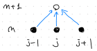
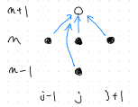
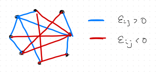
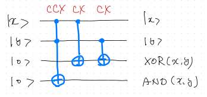
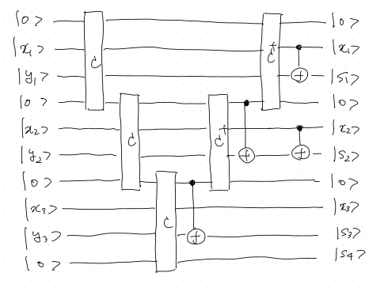
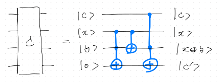

# 偏微分方程式の初期値問題

## 初期値問題と境界値問題

- 初期値問題

   - ある初期時刻で、時間発展に必要な状態が与えられているもの
   - 質点の運動など(時系列の問題)
- 境界値問題

   - 空間領域の境界で条件が与えられているもの
   - 物体の変形の計算や静電場の計算など(空間的に解く問題)
- 時間発展する偏微分方程式では、初期条件と空間の境界条件の両方が必要
- 空間を離散化すると、多数の変数に対する常微分方程式の初期値問題になる

## 一次元拡散方程式(放物型)

- 一次元拡散方程式: $u=u(x,t)$、$q=q(x,t)$は生成・吸収を表す項、$D>0$は拡散係数

   $$
   \frac{\partial u}{\partial t} - D \frac{\partial^2 u}{\partial x^2} = q
   $$

   - 初期条件: $u(x,0) = f(x)$ ($0\le x\le 1$)
   - 境界条件: $u(0,t) = u(1,t) = 0$
- 時間$t$と位置$x$に関して離散化

   $$
   \begin{aligned}
   & u_j^n = u(x_j, t_n) \\
   & q_j^n = q(x_j, t_n) \\
   & t_0 = 0, t_1=\Delta t, t_2=2 \Delta t, \cdots, t_n=n \Delta t, \cdots \\
   & x_0 = 0, x_1=\Delta x, x_2=2 \Delta x, \cdots, x_N=N \Delta x = 1 \qquad (\Delta x = 1/N)
   \end{aligned}
   $$

## 有限差分法

- $t$に関して前進差分を考える

   $$
   \frac{\partial u}{\partial t} \Big|_{(j \Delta x, n \Delta t)} = \frac{u_j^{n+1} - u_j^n}{\Delta t} + {\cal O}(\Delta t)
   $$
- $x$に関しては中心差分を考える

   $$
   \frac{\partial^2 u}{\partial x^2} \Big|_{(j \Delta x, n \Delta t)} = \frac{u_{j+1}^{n} - 2 u_{j}^{n} + u_{j-1}^{n}}{\Delta x^2} + {\cal O}(\Delta x^2)
   $$
- 拡散方程式に代入して整理すると

   $$
   u_{j}^{n+1} = u_{j}^{n} + r (u_{j+1}^{n} - 2 u_{j}^{n} + u_{j-1}^{n}) + \Delta t q_{j}^{n} \qquad (r = \frac{D\Delta t}{\Delta x^2})
   $$
- 空間方向の中心差分 + 時間方向のEuler法 = FTCS (Forward-Time Centered-Space)法

## FTCS法

- 時間1次・空間2次の陽解法: $O(\Delta t) + O(\Delta x^2)$

   {width="40%"}
- 初期条件

   $$
   u_j^0 = f(j\Delta x) \ \ (j=0,1,\cdots,N)
   $$
- 境界条件

   $$
   u_0^n = u_N^n = 0 \ \ (n=0,1,2,\cdots)
   $$

## 有限差分法の安定性

- 拡散方程式のFTCS法では、$\Delta x$だけを小さくすると不安定になる場合がある

   $$
   \begin{aligned}
   r = \frac{D \Delta t}{\Delta x^2}
   \end{aligned}
   $$
- 以下、拡散方程式の安定性解析と陰解法の説明では$q=0$とする
- $D>0$、$\Delta t>0$の場合の安定条件

   $$
   \begin{aligned}
   \begin{cases}
   r \le 1/2 & \text{安定} \\
   r > 1/2 & \text{\color{red}不安定}
   \end{cases}
   \end{aligned}
   $$
- 同じ$r$を保って$\Delta x$を半分にすると、$\Delta t$は1/4になる

   $\Rightarrow$ 同じ空間領域・時間区間では、格子点数が2倍、時間ステップ数が4倍なので計算量は約8倍

## von Neumannの安定性解析

- 周期境界条件または無限格子を考え、誤差の一つのフーリエ成分を調べる

   $$
   \begin{aligned}
   \epsilon_j^n &= A_k (\mu_k)^n e^{ikx_j} \qquad (x_j=j\Delta x)
   \end{aligned}
   $$
- 誤差も同じ差分方程式に従うので、FTCS法の式に代入すると

   $$
   \mu_k =  (1 + 2r(\cos k \Delta x - 1))
   $$
- 全ての$k$に対し発散しない($|\mu_k|$が1以下になる)ためには

   $$
   | 1 - 4r | \le 1 \qquad \text{すなわち} \ 0 < r \le \frac{1}{2}
   $$
- 両端を0に固定した場合も、正弦モードから同じ安定条件が得られる

## 一次元波動方程式(双曲型)

- 一次元波動方程式

   $$
   \frac{\partial^2 u}{\partial t^2} = c^2 \frac{\partial^2 u}{\partial x^2} \qquad u(x,0)=f(x), \frac{\partial u}{\partial t} (x,0) = g(x), c>0
   $$

- $t$に関する中心差分

   $$
   \frac{\partial^2 u}{\partial t^2} \Big|_{(j \Delta x, n \Delta t)} = \frac{u_{j}^{n+1} - 2 u_{j}^{n} + u_{j}^{n-1}}{\Delta t^2} + {\cal O}(\Delta t^2)
   $$
- 代入して整理すると

   $$
   u_{j}^{n+1} = 2u_{j}^{n} - u_{j}^{n-1} + \alpha^2 (u_{j+1}^{n} - 2 u_{j}^{n} + u_{j-1}^{n}) \qquad (\alpha = c\frac{\Delta t}{\Delta x})
   $$
- 解が安定であるための条件: $\displaystyle 0 < \alpha = c\frac{\Delta t}{\Delta x} \le 1$

## 波動方程式の時間・空間中心差分法

- 時間2次・空間2次の陽解法: $O(\Delta t^2) + O(\Delta x^2)$

   時間方向にも中心差分を使う3時刻の方法 (CTCS法)

   {width="40%"}
- $u^{n-1}$と$u^n$から$u^{n+1}$を計算するため、最初に$u^0$と$u^1$が必要

## 波動方程式の初期値の設定

- 初期条件

   $$
   u_j^0 = f(j\Delta x) \ \ (j=0,1,\cdots,N)
   $$

   初期速度$g_j=g(x_j)$については$n=0$に関する中心差分を考えて

   $$
   \begin{aligned}
   \frac{u_j^1 - u_j^{-1}}{2 \Delta t} &= g_j \\
   \Rightarrow \quad u_j^1 &= u_j^0 + \Delta t g_j + \frac{\alpha^2}{2} (u_{j+1}^{0} - 2 u_{j}^{0} + u_{j-1}^{0})
   \end{aligned}
   $$

## 波動方程式の安定性解析

- 誤差のフーリエ成分を$\epsilon_j^n=A_k(\mu_k)^n e^{ikx_j}$とおく

- 時間・空間中心差分の式に代入すると

   $$
   \begin{aligned}
   \mu_k^2 =  2\mu_k - 1 + 2\alpha^2(\cos k \Delta x - 1) \mu_k \\
   \mu_k^2 - 2 [1 + \alpha^2(\cos k \Delta x - 1)] \mu_k + 1 = 0
   \end{aligned}
   $$
- 二つの根の積は1。異なる実数根があると、一方の絶対値が1を超えて誤差が指数的に増大する
- 全ての波数$k$について根が単位円上にあるための条件 (CFL条件)

   $$
   | 1 - 2 \alpha^2 | \le 1 \qquad \text{すなわち} \ 0 < \alpha \le 1
   $$

## 時間に依存するシュレディンガー方程式

- 時間に依存するシュレディンガー方程式

   $$
   i \hbar \frac{\partial \Psi}{\partial t}(x,t) = H(t) \Psi(x,t) = \Big[ - \frac{\hbar^2}{2m} \frac{\partial^2}{\partial x^2} + V(x,t) \Big] \Psi(x,t)
   $$

   - $V$は実数とし、$H$がエルミートになる境界条件を課す (固定端・周期境界条件など)
   - 波動関数のノルムの2乗 $\displaystyle \|\Psi\|^2 = \int | \Psi(x,t) |^2 \, dx$ は保存
   - $V(x,t)$が時間$t$に依存しない場合、エネルギーの期待値は保存

      $$
      \langle H \rangle = \frac{\displaystyle \int \Psi^* H \Psi \, dx}{\displaystyle \int | \Psi |^2 \, dx}
      $$
- 以下では無次元化して$\hbar = m = 1$とおく

## 前進Euler法ではノルムが保存しない

- シュレディンガー方程式の形式解 ($V$が時間に依存しない場合)

   $$
   \Psi(x,t) = e^{-i t H} \Psi(x,0)
   $$
- 空間を離散化し、$\Psi^n$を波動関数のベクトル、$H$を離散化した行列とする
- $t$に関して前進差分 (前進Euler法)

   $$
   \begin{aligned}
   e^{-i t H} &= [e^{-i \Delta t H}]^M \approx [I - i \Delta t H]^M \qquad (\Delta t = t / M) \\
   \Psi^{n+1} &= (I - i \Delta t H) \Psi^{n}
   \end{aligned}
   $$

## ユニタリ性とノルムの保存

- $H^\dagger=H$ (エルミート) $\Rightarrow$ 時間発展演算子$e^{-i \Delta t H}$はユニタリ行列
- 差分近似$(I - i\Delta t H)$はユニタリではない

   $$
   \begin{aligned}
   & (e^{-i\Delta t H})^\dagger e^{-i\Delta t H} = e^{i\Delta t H} e^{-i\Delta t H} = I \\
   & (I-i\Delta t H)^\dagger (I-i\Delta t H) = I + {\color{red}\Delta t^2 H^2}
   \end{aligned}
   $$
- 刻み幅を小さくしても、非零エネルギーの固有成分は各ステップで増幅される

## クランク・ニコルソン法

- 時間に依存しない$H$に対するクランク・ニコルソン法 (時間2次)

   $$
   \Psi^{n+1} = \frac{(I - i \frac{\Delta t}{2} H)}{(I + i \frac{\Delta t}{2} H)} \Psi^n
   $$
- 更新行列はユニタリ行列なので、丸め誤差・連立方程式の求解誤差の範囲でノルムを保存
- 逆行列を陽に作らず、連立一次方程式として解く

   - まず、$\Phi = (I - i \frac{\Delta t}{2} H) \Psi^n$を計算
   - 次に、$(I + i \frac{\Delta t}{2} H) \Psi^{n+1} = \Phi$を解く
- 陰解法の一種。ノルムの保存だけでは位相の精度は保証されないので、$\Delta t$を変えて確認する

## 拡散方程式に対する陰解法

- 時刻$t$に関して後退差分を使う

   $$
   \frac{\partial u}{\partial t} \Big|_{(j \Delta x, n \Delta t)} = \frac{u_j^{n} - u_j^{n-1}}{\Delta t} + {\cal O}(\Delta t)
   $$
- $x$に関する中心差分と組み合わせ、$n \rightarrow n+1$と書き直すと

   $$
   u_{j}^{n+1} = u_{j}^{n} + r (u_{j+1}^{n+1} - 2 u_{j}^{n+1} + u_{j-1}^{n+1})
   $$

   $u^{n+1}$が両辺に現れる $\Rightarrow$ 陰解法
- $O(\Delta t) + O(\Delta x^2)$
- $r>0$の値によらず[常に安定]{.red} (無条件安定)。ただし大きな刻み幅では精度が低下する

## 拡散方程式に対するクランク・ニコルソン法

- 時刻$t_{n+1/2}$の時間微分を中心差分で近似し、空間の2階差分を前後の時刻で平均する

   $$
   \begin{aligned}
   \frac{u_j^{n+1}-u_j^n}{\Delta t} &= \frac{D}{2}\left(\delta_x^2 u_j^{n+1}+\delta_x^2 u_j^n\right) \\
   \delta_x^2 u_j^n &\equiv \frac{u_{j+1}^n-2u_j^n+u_{j-1}^n}{\Delta x^2}
   \end{aligned}
   $$
- $r=D\Delta t/\Delta x^2$を使って整理すると

   $$
   \begin{aligned}
   u_j^{n+1} &= u_j^n + \frac{r}{2}(u_{j+1}^{n+1}-2u_j^{n+1}+u_{j-1}^{n+1}) \\
   &\quad + \frac{r}{2}(u_{j+1}^n-2u_j^n+u_{j-1}^n)
   \end{aligned}
   $$

- 時間2次・空間2次の陰解法: $O(\Delta t^2) + O(\Delta x^2)$。$r>0$に対して無条件安定
- 三重対角の連立一次方程式を各ステップで解く

# 横磁場イジング模型

## 横磁場イジング模型

- 講義2-1の古典スピン$\sigma_i=\pm1$を、固有値$\pm1$の演算子$\sigma_i^z$に置き換える
- $N$スピンのハミルトニアン ($2^N \times 2^N$行列)

   $$
   \begin{aligned}
   H &= H_z + H_x \\
   H_z &= -J \sum_{\langle i,j \rangle} \sigma_i^z \sigma_j^z - h \sum_i \sigma_i^z \\
   H_x &= -\Gamma \sum_i \sigma_i^x
   \end{aligned}
   $$
- $J$: 相互作用 ($J>0$: 強磁性、$J<0$: 反強磁性)。各ボンドは1回だけ数える
- $h$: 縦磁場 (孤立スピンの$-h\sigma^z$による準位差$=2|h|$)
- $\Gamma$: 横磁場 (トンネリング)

## 量子スピンの演算子と基底

- $\sigma^x$、$\sigma^z$は$2\times2$のパウリ行列。$\sigma_i^a$はサイト$i$だけに作用する$2^N\times2^N$の演算子

   $$
   \sigma^z=\begin{pmatrix}1&0\\0&-1\end{pmatrix}, \qquad \sigma^x=\begin{pmatrix}0&1\\1&0\end{pmatrix}
   $$

   $$
   \begin{aligned}
   \big(\sigma_i^z\big)^2 &= \big(\sigma_i^x\big)^2 = I \\
   [ \sigma_i^z, \sigma_i^x ] &\ne 0
   \end{aligned}
   $$
- 以降、$\sigma_i^z$を対角化する基底($|\!\uparrow\rangle_i$, $|\!\downarrow\rangle_i$)で考える
- $\Gamma=0$の各配位のエネルギーは、古典イジング模型と一致する

## 横磁場イジング模型

- 2サイトを1本のボンドで結んだ系

   $$
   H = -J \sigma_1^z \sigma_2^z - h (\sigma_1^z + \sigma_2^z) - \Gamma (\sigma_1^x + \sigma_2^x)
   $$
- 行列要素

   $$
   \begin{aligned}
   \langle \uparrow \uparrow \!| H |\! \uparrow \uparrow \rangle &= -J - 2h \\
   \langle \uparrow \uparrow \!| H |\! \uparrow \downarrow \rangle &= -\Gamma \\
   \langle \uparrow \uparrow \!| H |\! \downarrow \downarrow \rangle &= 0 \\
   &\vdots
   \end{aligned}
   $$

## 量子相転移

- 強磁性$J>0$、$h=0$、$\Gamma\ge0$を考える

   - $\Gamma=0$: $|\!\uparrow\uparrow\cdots\uparrow\rangle$と$|\!\downarrow\downarrow\cdots\downarrow\rangle$が縮退した基底状態を張る
   - $J=0$、$\Gamma>0$: $|+\rangle^{\otimes N}$が基底状態

      $|+\rangle=(|\!\uparrow\rangle+|\!\downarrow\rangle)/\sqrt{2}$。全$2^N$配位の等振幅の重ね合わせ
- 一次元系

   $$
   H = - J \sum_{i} \sigma_i^z \sigma_{i+1}^z - \Gamma \sum_i \sigma_i^x
   $$

   温度0・熱力学極限$N\to\infty$で$\Gamma=J$に量子相転移 (量子ゆらぎによる相転移)
- 有限の$N$では、$\Gamma>0$の基底状態は通常は重ね合わせであり、厳密な相転移は現れない

# 多体量子系の時間発展

## 横磁場イジング模型の時間発展

- $H$が時間に依存しない場合の形式解 ($\hbar=1$)

   $$
   \Psi(t) = e^{-iHt} \Psi(0)
   $$

   - 前進Euler法はノルムを保存しない。クランク・ニコルソン法では連立方程式を解く
- 講義2-2のシンプレクティック積分と同じ考え方で、計算しやすい演算子の積に分解する
- 鈴木・トロッター分解 ($\Delta t=t/M$)

   $$
   \begin{aligned}
   e^{-iHt} &= \big[e^{-iH\Delta t}\big]^M \approx \big[e^{-iH_z\Delta t}e^{-iH_x\Delta t}\big]^M \\
   e^{-iH_x\Delta t} &= \prod_{i=1}^N e^{i\Gamma\sigma_i^x\Delta t}
   \end{aligned}
   $$

- 1ステップの誤差は$O(\Delta t^2)$、同じ時間$t$までの累積誤差は$O(\Delta t)$

## 保存則を保つ演算子分解

- $H_z$は対角行列なので、$e^{-iH_z\Delta t}$は各配位の振幅に位相を掛けるだけ
- $[\sigma_i^x]^2 = I$より

   $$
   e^{i\Gamma \sigma_i^x\Delta t} = I \cos (\Gamma\Delta t) + i \sigma_i^x \sin (\Gamma\Delta t)
   $$
- 講義2-2の2次の分解と同じ対称化

   $$
   e^{-iH\Delta t} = e^{-iH_z\Delta t/2}e^{-iH_x\Delta t}e^{-iH_z\Delta t/2} + O(\Delta t^3)
   $$

   同じ時間$t$までの累積誤差は$O(\Delta t^2)$
- 各因子がユニタリなので、分解後もノルムを保存。ただし、一般には元の$H$のエネルギーを厳密には保存しない

## 量子アニーリング

- 講義2-1のイジング模型を、符号や強さがボンドごとに異なる相互作用へ拡張する

   $$
   H = -J \sum_{i<j} \epsilon_{ij} \sigma_i^z \sigma_j^z
   $$

- $\epsilon_{ij}$は与えられた実数の結合係数 ($0$なら結合なし)。各ペアは1回だけ数える
- 離散最適化問題: この$H$の基底状態配位と基底状態エネルギーを求めたい

   {width="60%"}

## 量子アニーリング

- 横磁場を導入

   $$
   H(t) = -J(t) \sum_{i<j} \epsilon_{ij} \sigma_i^z \sigma_j^z - \Gamma(t) \sum_i \sigma_i^x
   $$
- 古典極限 ($J=1$, $\Gamma=0$)

   - 求めたい配位を基底状態に持つ
- 量子極限 ($J=0$, $\Gamma=1$)

   - 準備しやすい初期基底状態$\Psi(0)=|+\rangle^{\otimes N}$
- 量子アニーリング

   - エネルギーの単位を固定して$J+\Gamma=1$とし、$\Gamma$を1から0まで減らす

      $$
      J(t)=1-\Gamma(t)=t/\tau \qquad (0\le t\le\tau)
      $$
   - $\tau$: アニーリング時間

## 量子アニーリングの条件と数値計算

- 孤立系を初期基底状態から出発させ、励起状態への遷移を抑えるほどゆっくり変化させる (断熱時間発展)
- 必要な$\tau$は、途中のエネルギーギャップと$H$の変化率に依存する

   - 断熱定理の条件を満たせば、$\tau\to\infty$で最終的な基底状態部分空間に入る確率が1に近づく
   - 基底状態が縮退していれば、その重ね合わせになることもある。基底状態部分空間内での測定結果はいずれも最適解
   - ギャップが小さい問題では、必要な時間が非常に長くなる場合がある
- $H(t)$が変化するので、時間全体を単一の$e^{-iHt}$では書けない

# 量子回路シミュレーション

## 量子コンピュータと量子ゲート

- (ゲート型)量子コンピュータ

   $N$量子ビットに対して、量子ゲートにより状態を操作

   - 「量子ビット」= 2準位系 ($S=1/2$スピン) \ $|0\rangle=|\!\uparrow\rangle, |1\rangle=|\!\downarrow\rangle$
   - 「量子ゲート」= 少数量子ビットに対するユニタリ変換

## 1量子ビットゲート

- Xゲート (量子NOT)

   $$
   X = \begin{pmatrix} 0 & 1 \\ 1 & 0 \end{pmatrix} = \sigma^x
   $$
- Rzゲート ($z$軸まわりの回転)

   $$
   R_z(\theta) = \begin{pmatrix} e^{-i\theta/2} & 0 \\ 0 & e^{i\theta/2} \end{pmatrix} = e^{-i\theta\sigma^z/2}
   $$
- アダマールゲート

   $$
   H = \frac{1}{\sqrt{2}} \begin{pmatrix} 1 & 1 \\ 1 & -1 \end{pmatrix} = \frac{1}{\sqrt{2}} (\sigma^x + \sigma^z)
   $$

## 2量子ビットゲート

- 基底は$|00\rangle,|01\rangle,|10\rangle,|11\rangle$の順。左側の量子ビットを先に書く
- 2量子ビットゲート

   - CXゲート (左の量子ビットが1なら、右の量子ビットを反転)

      $$
      CX = \begin{pmatrix} 1 & 0 & 0 & 0 \\ 0 & 1 & 0 & 0 \\ 0 & 0 & 0 & 1 \\ 0 & 0 & 1 & 0 \end{pmatrix}
      $$

## 3量子ビットゲート

- 基底は$|000\rangle,|001\rangle,\ldots,|111\rangle$の順

- CCXゲート (トフォリゲート。左の2ビットが共に1なら、右端を反転)

   $$
   CCX = \begin{pmatrix}
   1 & 0 & 0 & 0 & 0 & 0 & 0 & 0 \\
   0 & 1 & 0 & 0 & 0 & 0 & 0 & 0 \\
   0 & 0 & 1 & 0 & 0 & 0 & 0 & 0 \\
   0 & 0 & 0 & 1 & 0 & 0 & 0 & 0 \\
   0 & 0 & 0 & 0 & 1 & 0 & 0 & 0 \\
   0 & 0 & 0 & 0 & 0 & 1 & 0 & 0 \\
   0 & 0 & 0 & 0 & 0 & 0 & 0 & 1 \\
   0 & 0 & 0 & 0 & 0 & 0 & 1 & 0 \end{pmatrix}
   $$

## 量子加算器

- 2個の1ビット$x,y$の加算 (半加算器) は、CCXゲートとCXゲートで実現できる

   {width="50%"}

   和は$x\oplus y$、桁上がりは$xy$。入力$x,y$も保持するので可逆
- CCXゲートは、Hゲート、Rzゲート、CXゲートの組み合わせで表現できる (全体位相を除く)
- 任意の角度$\theta$の$R_z(\theta)$を使えば、Hゲート、$R_z(\theta)$、CXゲートは万能 (全体位相を除く)

## 量子加算器

- 3ビットの数$x,y$を加算し、桁上がりを含む4ビットの和を得る回路

   {width="60%"}
   {width="35%"}

## 疎行列ベクトル積による実装

- 状態ベクトル

   - 長さ$2^N$の複素ベクトル ($N$: スピン数、量子ビット数)
- 1量子ビット演算(例: $\sigma^x_2$)

   - 局所行列$\sigma^x$は$2\times2$
   - サイト2への作用を全系に埋め込むと、$2^N\times2^N$行列

      $$
      {I}_2 \otimes \sigma^x \otimes {I}_2 \otimes \cdots \otimes {I}_2
      $$
   - 次元は大きいが、非ゼロ要素は各行各列に1個だけ
   - CXやCCXゲートも同様

## 行列を作らずに量子ゲートを作用させる

- 疎行列ベクトル積

   - $2^N\times2^N$行列を陽に構成するのは非効率

      密行列を保存・乗算すると、メモリ・1回の計算時間とも$O(2^{2N})$
   - X・CX・CCXは配位の置換。振幅を対応する相手と交換するだけでよい
   - $R_z$は位相を掛け、Hゲートは対応する2個の振幅を線形結合する

      1個のゲートの計算時間は$O(2^N)$
- 状態ベクトル自体のメモリは$O(2^N)$。その場で更新すれば、作業領域は追加で$O(1)$
- 全$N$サイトへのゲート適用は$O(N2^N)$。疎性を使っても、一般の状態ベクトルの指数的な増大は残る

## 計算結果をどう確かめるか

- 数値計算では誤差を見積もって結果を判断する
- 刻み幅を$\Delta t,\Delta t/2,\Delta t/4$と変えて収束を確認
- 拡散・波動方程式では、安定条件と境界条件を確認し、$\Delta x$も変える
- 時間に依存しない量子系では、ノルムとエネルギー期待値の誤差を調べる
- 量子アニーリングでは$H(t)$が変わるためエネルギーは保存しない。$\Delta t$による誤差と有限の$\tau$による励起を区別する

## 講義日程 (予定)

- 全8回 (金曜5限 16:50-18:35)

   - 10月2日(金) 講義1: モンテカルロ法と統計力学
   - [10月9日 休講]{.gray}
   - 10月16日(金) 実習1
   - 10月23日(金) 講義2: 分子動力学と統計的サンプリング
   - 10月30日(金) 実習2
   - [11月6日 休講]{.gray}
   - 11月13日(金) 講義3: 偏微分方程式と量子系の時間発展
   - 12月4日(金) 実習3
   - [12月11日 休講]{.gray}
   - 12月18日(金) 講義4: 自動微分・共役勾配法と最適化の応用
   - [12月25日 休講]{.gray}
   - 1月8日(金) 実習4
   - [1月22日・29日 休講]{.gray}
